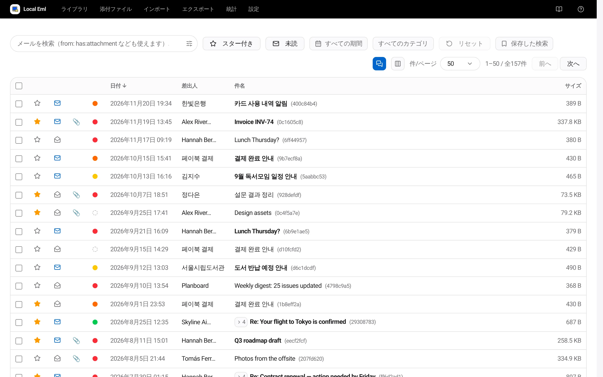

# Local Eml

[English](README.md) · [한국어](README_ko.md) · [日本語](README_ja.md) · **[ドキュメント](https://hwhang0917.github.io/local-eml/docs/ja/)**

[](https://github.com/hwhang0917/local-eml/actions/workflows/ci.yml)
[](https://github.com/hwhang0917/local-eml/actions/workflows/release.yml)
[](LICENSE)
[](https://github.com/hwhang0917/local-eml/releases)

Local Emlは古いメールを自分のコンピューターに保管し、オフラインで検索して読めるようにするプログラムです。`.eml`ファイル、フォルダ、`.zip`、`.mbox`、Outlookの`.pst`を取り込めるほか、IMAPアカウントやS3バケット（AWS、またはMinIO、Cloudflare R2、Backblaze B2などのS3互換サービス）からメールを取得することもできます。メールがコンピューターの外に出ることはありません。

アーカイブのための道具です。メールボックスがいっぱいになったら、古いメールを取り出して通常の`.eml`ファイルとして保管しておけば、あとからいつでも探せます。

メールクライアントではありません。メールの作成、送信、返信はできず、メールボックスの内容を変更することもありません。IMAPへのアクセスは読み取り専用です。デスクトップコンピューター専用で、接続できるのは自分のコンピューターだけです。



## できること

- **すべてのメールをまとめて検索。** 差出人、宛先、件名、本文、添付ファイル名を検索でき、`from:alice`、`has:attachment`、`after:2019`などのフィルターも使えます。日本語・韓国語・中国語は設定なしで検索でき、ハングルの初声検索（`ㅎㄱ`で한국）にも対応しています。よく使う検索は保存しておけます。
- **安全に読む。** HTMLメールは制限をかけたフレームの中に表示され、外部画像はブロックされます。リンクは実際の行き先を先に表示し、フィッシングらしいメールには警告が出ます。ハングル（HWP、HWPX）、Word、Excelの添付ファイルもアプリ内で開けます。
- **添付ファイルを探す。** 添付ファイルページにはすべてのメールのファイルがまとまっているので、どのメールに付いていたか覚えていなくても、名前、種類、差出人、日付でPDFを見つけられます。
- **新着メールを受け取る。** IMAPプロファイルでバックグラウンド同期をオンにすると、IMAP IDLEに対応したサーバーでは新着メールが数秒で届き、デスクトップ通知も受け取れます。パスワードは暗号化して保存され、その鍵はシステムのキーチェーン（資格情報マネージャー、キーチェーン、LinuxのSecret Service）に、それがない環境では自分だけが読めるファイルに置かれます。
- **整理する。** 複数のメールを選んでまとめて既読・未読にしたり削除したりでき、読んでいるメールをその場で削除することもできます。メール全体を印刷したり、PDFとして保存したりできます。**設定 → 重複メール**では、2回取り込まれたメールを見つけて1つだけ残せます。
- **全体を把握する。** 統計ページでは、メール数の推移、メールが届く時間帯、多く送ってくる差出人、何が容量を使っているかがわかります。
- **持ち出す。** ライブラリ全体を1つの`.zip`としてエクスポートしたり、AWS S3やS3互換サービスにアップロードしたりできます。一部だけを渡したいときは、検索結果や選択したメールを`.eml`ファイル、1つの`.mbox`、PDFとしてエクスポートできます。
- **バックアップする。** 自動バックアップが、毎日または毎週、新しいメールを外付けドライブ、NAS、クラウドで同期しているフォルダにコピーします。

アプリとドキュメントは日本語、英語、韓国語で利用できます。

## ダウンロード

[最新リリース](https://github.com/hwhang0917/local-eml/releases/latest)からお使いのシステム用のファイルを入手し、ダブルクリックします。Local Emlは専用のウィンドウで開き、ウィンドウを閉じると終了します。インストーラーもアカウントも不要です。WindowsとmacOSでは初めて開くときに警告が表示されます。対処方法は[インストールガイド](https://hwhang0917.github.io/local-eml/docs/ja/install)にあります。

Windowsでは、wingetへの登録が承認されれば`winget install hwhang0917.LocalEml`も使えるようになります。

常に起動しておきたい場合は、バックグラウンドサービスとしてインストールできます。コンピューターの起動と同時に立ち上がり、IMAPアカウントの新着メールを受信し続けます。

```bash
# Linux / macOS
curl -fsSL https://raw.githubusercontent.com/hwhang0917/local-eml/main/scripts/install.sh | sh
```

```powershell
# Windows (PowerShell)
irm https://raw.githubusercontent.com/hwhang0917/local-eml/main/scripts/install.ps1 | iex
```

インストールが終わったら<http://localhost:7878>を開きます。初回はセッショントークンを求められ、`local-eml token`コマンドで取得する方法が画面に表示されます。プログラムをダブルクリックして開くこともでき、その場合は自動的にサインインされます。ポートの変更、ダウンロードしたファイルの確認、アップデート、アンインストールについては[インストールガイド](https://hwhang0917.github.io/local-eml/docs/ja/install)を参照してください。

## ドキュメント

手順ガイドは次のとおりです。

- [.emlファイルを開く](https://hwhang0917.github.io/local-eml/docs/ja/how-to/open-eml-files)
- [Google データエクスポートの.mboxを見る](https://hwhang0917.github.io/local-eml/docs/ja/how-to/takeout-mbox)
- [Outlookなしで.pstを開く](https://hwhang0917.github.io/local-eml/docs/ja/how-to/pst-without-outlook)
- [Gmailの容量を空ける](https://hwhang0917.github.io/local-eml/docs/ja/how-to/free-up-gmail)

[ドキュメント全体](https://hwhang0917.github.io/local-eml/docs/ja/)では、[インポート](https://hwhang0917.github.io/local-eml/docs/ja/import)、[検索](https://hwhang0917.github.io/local-eml/docs/ja/search)（ハングルの初声検索を含む）、[添付ファイルの探し方](https://hwhang0917.github.io/local-eml/docs/ja/attachments)、[ライブラリの統計](https://hwhang0917.github.io/local-eml/docs/ja/stats)、[新着メールの受信](https://hwhang0917.github.io/local-eml/docs/ja/sync)、[迷惑メールとフィッシングの警告](https://hwhang0917.github.io/local-eml/docs/ja/spam-phishing)、[データの保存場所](https://hwhang0917.github.io/local-eml/docs/ja/privacy)、[設定とコマンドライン](https://hwhang0917.github.io/local-eml/docs/ja/settings-cli)、[トラブルシューティング](https://hwhang0917.github.io/local-eml/docs/ja/troubleshooting)についても説明しています。

## コントリビュート

ソースからビルドして実行する方法は[`docs/DEVELOPMENT.md`](docs/DEVELOPMENT.md)（英語）にあります。issueやプルリクエストを作成する前に[`CONTRIBUTING.md`](CONTRIBUTING.md)（英語）をお読みください。Local Emlが利用しているライブラリのライセンスは、アプリの**設定 → オープンソースライセンス**で確認できます。

## ライセンス

[GNU General Public License v3.0](LICENSE)
